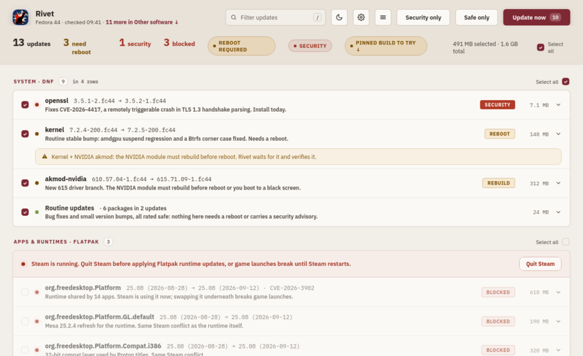

<div align="center">


# Rivet

**Updates for Fedora GNOME, with a reason next to each one.**

[](https://github.com/NelsonScott/rivet/actions/workflows/ci.yml)
[](https://github.com/NelsonScott/rivet/releases/latest)
[](https://copr.fedorainfracloud.org/coprs/scottnelson/rivet-updater/)
[](LICENSE)



<sub>Demo data</sub>

</div>

Rivet replaces GNOME Software for updates. It shows every pending dnf, Flatpak and
firmware update in one list, says in one line what each one does, and colours it
green, yellow or red so you know which ones to read before you click. It also keeps
an eye on the software GNOME Software never sees.

## Features

- One list for dnf, Flatpak and fwupd, checked hourly by a user timer, with a top-bar
  badge when something is waiting.
- Each update rated green / yellow / red by fixed rules (security advisories,
  kernel, drivers, runtimes), with a short plain reason drawn from the release notes.
- Kernel plus NVIDIA akmod updates wait for the module to build and verify it before
  a reboot is offered, so you do not restart into a black screen.
- Flatpak runtime updates are held while Steam is running, and a Flatpak you pinned
  with `flatpak mask` can be tried again safely and rolled back if it breaks.
- Other software: stale npm, pipx, uv and cargo tools, GNOME extensions, AppImages,
  containers and Home Assistant updates, each with what it is and who uses it.
- When a run fails, Fix it asks Claude Code to look at the logs and propose a fix you
  approve step by step.

## Install

### COPR (Fedora 44 and Rawhide)

```sh
sudo dnf copr enable scottnelson/rivet-updater
sudo dnf install rivet-updater
systemctl --user start rivet-collect.timer    # the hourly timer, now (otherwise from your next login)
systemctl --user start rivet-collect.service  # check now, once
rivet-updater                                 # or open "Rivet" from the app grid
```

For the top-bar badge, log out and back in once (GNOME Shell only sees a newly installed
extension after that), then run `gnome-extensions enable rivet@scottnelson.xyz`.

The package enables the hourly `rivet-collect.timer` for every user through a
systemd preset. The app lives in `/usr/share/rivet`, the CLIs (`rivet-updater`,
`rivet-collect`, `rivet-apply`, `rivet-doctor`) in `/usr/bin`.

### From source (user scope)

```sh
sudo dnf install git python3-gobject python3-rpm gtk4 libadwaita webkitgtk6.0 \
    flatpak flatpak-libs dnf5daemon-server polkit desktop-file-utils gtk-update-icon-cache
git clone https://github.com/NelsonScott/rivet && cd rivet
./install.sh          # CLIs in ~/.local/bin, the hourly user timer
app/install.sh        # the app: launcher, desktop entry, icon
rivet-updater         # or open "Rivet" from the app grid
```

Only the `dnf install` line needs sudo; everything else lands in your home directory.
The top-bar badge is the GNOME Shell extension in `shell-ext/rivet@scottnelson.xyz`:
copy it to `~/.local/share/gnome-shell/extensions/`, log out and back in, then
`gnome-extensions enable rivet@scottnelson.xyz`. A from-source install in
`~/.local/bin` takes precedence over the RPM's `/usr/bin` CLIs.

To build the RPM yourself: `packaging/rpm/make-srpm.sh` writes a source RPM to
`packaging/rpm/out/`, then `rpmbuild --rebuild` it (or `mock`).

If you use Rivet, turn off GNOME Software's automatic update downloads (Software,
Preferences, Automatic Updates off; or `gsettings set org.gnome.software
download-updates false`) so the two do not race for the same transactions.

## Requirements and privacy

Fedora 44 Workstation (GNOME, Wayland). Stock Workstation already has nearly all of
the `dnf install` line above; `fwupd` (firmware), `mokutil` (Secure Boot state) and
`libnotify` are used when present. The app icon ships pre-rendered, so installing
needs no image tools.

What it reads: the dnf metadata and rpm database, `flatpak` remotes and masks,
`fwupd`, Secure Boot state (`mokutil`), and for Other software the version lists of
the tools you have installed (npm, PyPI, crates.io, extensions.gnome.org, Docker Hub,
quay.io). It writes only under `~/.config/rivet` and `~/.local/state/rivet`. The
page loads nothing from the web: its fonts (Manrope, Inter) ship with the app.

What needs root, and why: installing packages goes through dnf5daemon's own polkit
prompt, once per run, the same as GNOME Software. `pkexec` is used for three things
only: retrying an NVIDIA akmods build that lost the rpm lock, a root step of a Fix it
plan you approved, and rolling back a pinned Flatpak. The machine restarts only when
you press Restart and confirm.

Optional parts, shown only when present:

- **Claude Code**: see below.
- **Home Assistant**: create a long-lived access token (your Home Assistant profile,
  Security tab) and put it in `~/.config/rivet/ha.env`, readable only by you:

  ```sh
  install -m 600 /dev/null ~/.config/rivet/ha.env
  echo 'HA_TOKEN=paste-the-token-here' >> ~/.config/rivet/ha.env
  echo 'HA_URL=http://homeassistant.local:8123' >> ~/.config/rivet/ha.env   # only if yours differs
  ```

  `HA_TOKEN` and `HA_URL` in the environment win over the file. Without a token
  nothing about Home Assistant is shown. Rivet never logs or copies the token.

## Claude Code, optional

Rivet works fully without Claude Code: the fixed rules colour every update, each one
gets a plain reason from the rules and its release notes, and every update and
rollback works the same. With the [Claude Code](https://claude.com/claude-code) CLI
installed (`claude` on PATH) and logged in, two things become available:

- **Explain and rate updates** (Preferences, off by default). When you turn it on,
  each hourly check runs `claude -p` to write a one-line reason per update (it may
  raise a colour, never lower it), and once per name a "what is this" line for the
  rows under Other software. What is sent: package names, versions, advisory titles
  and release-note excerpts, and the names of the tools listed under Other software.
  Verdicts are cached, so an unchanged list sends nothing again.
- **Fix it**, a button on a failed run. Only when you press it, `claude -p --model
  opus` (sonnet if opus has no usage left) reads that run's log, the rpm database and
  the journal with read-only tools and proposes a fix you approve step by step.

Both go through your own Claude Code login and count against your own Claude plan.
Rivet never reads an API key and never talks to Anthropic itself. With the setting
off and Fix it not pressed, nothing is sent.

## Develop

```sh
cd backend && python3 -m unittest discover -s tests   # backend tests
python3 app/selftest.py                               # the app bridge, no window
python3 app/qa/looks-contrast.py                      # colour contrast of every look
timeout 900 dbus-run-session -- bash app/qa-e2e.sh /tmp/rivet-e2e   # the real app in a nested headless GNOME Shell
```

The end-to-end suite drives the real GTK/WebKit app against fake backends and saves
screenshots; it never touches your session or runs a real package transaction.
`CONTRACT.md` describes the files and messages between the parts, and
`docs/QA-MATRIX.md` the failure scenarios the suite covers.

## License

MIT, see `LICENSE`. The bundled Manrope and Inter fonts are under the SIL Open Font
License (`app/ui/fonts/OFL-Manrope.txt`, `app/ui/fonts/OFL-Inter.txt`).
